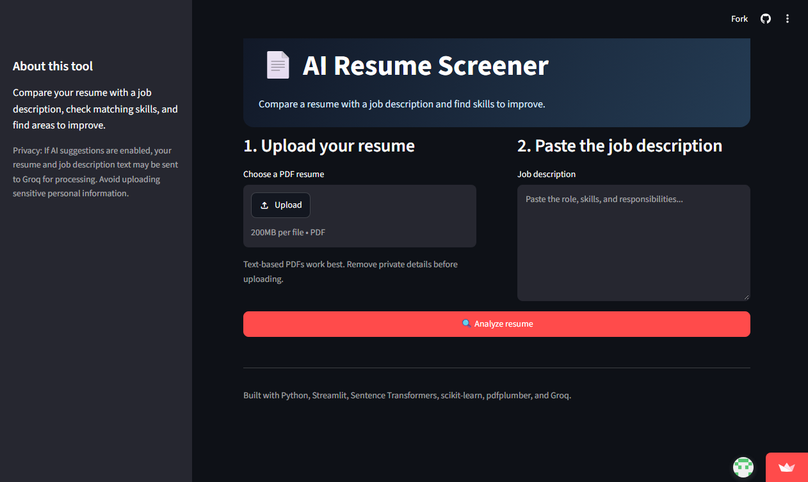

<div align="center">

# 📄 AI Resume Screener
### *An Intelligent Resume–Job Description Alignment & Skill Gap Analyzer*

[](https://www.python.org/)
[](https://streamlit.io/)
[](https://huggingface.co/sentence-transformers/all-MiniLM-L6-v2)
[](https://groq.com/)
[](LICENSE)
[](https://resume-screener-fl9mggq8t6kvww6xn6pvbf.streamlit.app/)

[Live Demo](https://resume-screener-fl9mggq8t6kvww6xn6pvbf.streamlit.app/) • [About This Project](#-about-this-project) • [Key Features](#-key-features) • [How It Works](#-how-it-works) • [Run Locally](#-how-to-run-locally) • [License](#-license) • [What I Learned](#-key-learnings--takeaways)

</div>

---

## 🚀 Live Demo

Try the deployed web app right in your browser:
👉 **[Launch AI Resume Screener](https://resume-screener-fl9mggq8t6kvww6xn6pvbf.streamlit.app/)**

<br>

<div align="center">
  
</div>

---

## 📖 About This Project

Hi! I'm **Deepak Pradhan**, a student learning and progressing in **Machine Learning, Natural Language Processing (NLP), and Full-Stack Python Development**.

When applying for technical roles or reviewing candidate resumes against modern job requirements, keyword matching alone often falls short. Traditional ATS (Applicant Tracking Systems) either look for exact words or miss contextual overlap. 

I built the **AI Resume Screener** to explore how modern NLP techniques can solve this problem:
- **Semantic Text Matching:** Using dense sentence embeddings (`all-MiniLM-L6-v2`) to capture context and meaning, rather than just raw keyword counting.
- **Skill Gap Identification:** Pinpointing which hard and soft skills are present in both the resume and the job description, and identifying missing requirements.
- **Actionable AI Feedback:** Integrating an LLM via the **Groq API** to provide grounded, constructive improvement suggestions without inventing false qualifications.
- **Clean User Experience:** Creating an accessible, responsive web application using **Streamlit** that lets users upload a PDF, paste any job post, view metrics instantly, and download a screening report.

---

## ✨ Key Features

| Feature | Description |
| :--- | :--- |
| **📄 PDF Resume Parsing** | Extracts clean textual data from uploaded PDF resumes using `pdfplumber`. |
| **🧠 Semantic Similarity** | Computes cosine similarity between high-dimensional dense embeddings generated by `sentence-transformers`. |
| **🎯 Matched Skills & Gap Analysis** | Compares skills against a curated taxonomy across programming languages, frameworks, cloud tools, and soft skills. |
| **💡 AI Coaching via Groq** | Uses fast LLM inference (`openai/gpt-oss-20b`) to provide concise, honest suggestions for bridging identified gaps. |
| **📊 Interactive Visual Dashboard** | Visual metrics with progress bars, matched skill tags, and transparent score explanations. |
| **⬇️ Exportable Screening Report** | Generates a structured `.txt` summary file ready to save and reference offline. |
| **🛡️ Input Validation & Safety** | Checks for corrupt files, scanned non-OCR PDFs, and minimum character thresholds with helpful user prompts. |

---

## ⚙️ How It Works (Pipeline Architecture)

```
┌──────────────────────────┐         ┌──────────────────────────┐
│   Candidate Resume PDF   │         │     Job Description      │
└────────────┬─────────────┘         └────────────┬─────────────┘
             │                                    │
             ▼                                    ▼
     [ pdfplumber ]                         [ Raw Text ]
  (Text Extraction)                               │
             │                                    │
             ├─────────────────┬──────────────────┤
             │                 │                  │
             ▼                 ▼                  ▼
   ┌───────────────────┐ ┌───────────────┐ ┌───────────────────┐
   │ Skill Detection   │ │ MiniLM-L6-v2  │ │ Skill Detection   │
   │ (Resume Skills)   │ │ Embeddings    │ │ (Job Skills)      │
   └─────────┬─────────┘ └───────┬───────┘ └─────────┬─────────┘
             │                   │                   │
             │         [ Cosine Similarity ]         │
             │                   │                   │
             ▼                   ▼                   ▼
    ┌────────────────────────────────────────────────────────┐
    │     Matched Skills & Identified Skill Gaps             │
    └──────────────────────────┬─────────────────────────────┘
                               │
                               ▼
    ┌────────────────────────────────────────────────────────┐
    │              Groq LLM Coaching Inference               │
    │  (Practical suggestions based on missing requirements)  │
    └──────────────────────────┬─────────────────────────────┘
                               │
                               ▼
    ┌────────────────────────────────────────────────────────┐
    │           Streamlit Interactive Web UI                 │
    │  - Semantic score gauge & breakdown                    │
    │  - Downloadable screening report (.txt)                │
    └────────────────────────────────────────────────────────┘
```

---

## 🛠️ Tech Stack

- **Frontend & App Framework:** [Streamlit](https://streamlit.io/)
- **Embeddings & NLP:** [Sentence Transformers](https://www.sbert.net/) (`all-MiniLM-L6-v2`)
- **Similarity Computation:** [scikit-learn](https://scikit-learn.org/) (`cosine_similarity`)
- **PDF Extraction:** [pdfplumber](https://github.com/jsvine/pdfplumber)
- **Generative AI / LLM:** [Groq API](https://groq.com/)
- **Language & Runtime:** Python 3.10+

---

## 📂 Project Structure

```text
resume-screener/
│
├── sample_data/             # Sample inputs for testing
│   ├── sample_resume.pdf    # Sample PDF resume
│   ├── jd_close_match.txt   # Highly aligned sample job description
│   ├── jd_partial_match.txt # Partially aligned sample job description
│   └── jd_unrelated.txt     # Unrelated sample job description
├── tests/                   # Automated unit test suite
│   ├── test_skills.py       # Unit tests for skill extraction & gap detection
│   └── test_extract.py      # Unit tests for PDF parsing & boundary handling
├── app.py                   # Main Streamlit web application
├── extract.py               # PDF text extraction utility
├── match.py                 # Semantic similarity embedding module
├── analyze.py               # Groq LLM suggestion module
├── screenshot.png           # Application preview screenshot
├── requirements.txt         # Project dependencies
├── .gitignore               # Git ignore rules (secrets, venv, caches)
└── README.md                # Project documentation
```

---

## 💻 How to Run Locally

If you'd like to test or run this project on your own computer:

### 1. Clone the repository
```bash
git clone https://github.com/deepakpradhan1021/resume-screener.git
cd resume-screener
```

### 2. Set up a virtual environment
```bash
# Windows
python -m venv .venv
.\.venv\Scripts\activate

# macOS / Linux
python3 -m venv .venv
source .venv/bin/activate
```

### 3. Install dependencies
```bash
pip install -r requirements.txt
```

### 4. Run automated tests
```bash
python -m unittest discover -s tests
```

### 5. Configure Groq API Key (Optional for AI suggestions)
Create a `.streamlit/secrets.toml` file in the project root:
```toml
GROQ_API_KEY = "your_groq_api_key_here"
```
*(Make sure `.streamlit/` remains in your `.gitignore` so your API key stays private).*

### 6. Launch the application
```bash
streamlit run app.py
```
Open your browser at **`http://localhost:8501`**.

---

## 🔒 Privacy & Limitations

- **Text Similarity $\neq$ Hiring Guarantee:** The score represents semantic cosine similarity between the two texts, not a candidate's actual capability or a hiring probability.
- **Scanned Documents:** Text extraction requires text-based PDFs. Image-based or scanned PDFs require OCR preprocessing.
- **Privacy Notice:** When AI suggestions are triggered, resume and job description text are sent to Groq for model inference. Do not upload sensitive personal data (e.g. SSN, bank details, confidential contact info).

---

## 💡 Key Learnings & Takeaways

Building this project taught me several foundational concepts in Applied AI and Python:
- **Dense Embeddings vs. Lexical Search:** Why sentence transformers capture semantic context (e.g., understanding that "building REST APIs in Python" relates to "backend web services") much better than simple word-counting.
- **Handling PDF Ingestion:** Managing varying PDF layouts and edge cases (empty pages, binary artifacts) gracefully using `pdfplumber`.
- **Integrating Low-Latency LLM APIs:** Structuring system and user prompts with the Groq API to produce concise, grounded recommendations without hallucinating experience.
- **Deploying Interactive Apps:** Packaging models, managing cloud environment secrets (`st.secrets`), and caching transformer models with `@st.cache_resource` for smooth user interactions.

---

## 🔮 Future Improvements

- [ ] Add OCR support (via `pytesseract` or `easyocr`) for scanned resume PDFs.
- [ ] Expand skill dictionary with regex-based synonym grouping and automated taxonomy extraction.
- [ ] Support multiple resume comparisons against a single job description.
- [ ] Add PDF export option alongside the current plain text report.

## 📜 License

This project is open source and available under the [MIT License](LICENSE).

---

## 👤 Author

**Deepak Pradhan**
- 🐙 GitHub: [@deepakpradhan1021](https://github.com/deepakpradhan1021)
- 🚀 Project Live Demo: [Streamlit App](https://resume-screener-fl9mggq8t6kvww6xn6pvbf.streamlit.app/)
- *Always open to constructive feedback, suggestions, and learning opportunities!*
